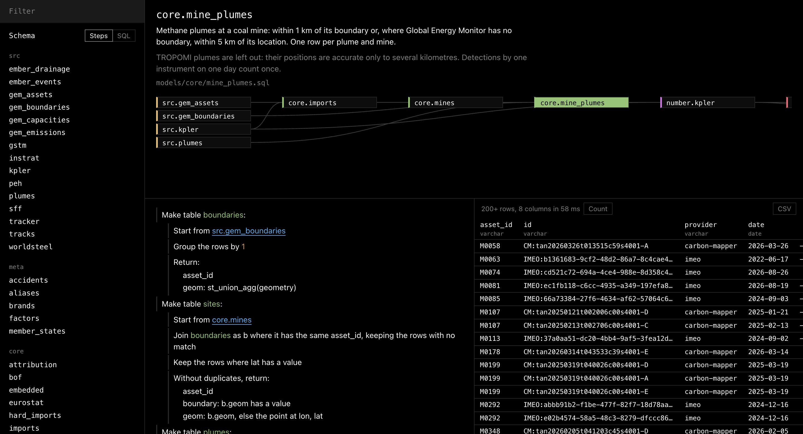

# duckdb.mk

"DuckDB and Make are all you need!"

duckdb.mk is a minimal, highly opinionated build system for local DuckDB
projects, inspired by [dbt](https://www.getdbt.com/) and implemented as a short
Makefile. Write interlinked `SELECT` queries in an organised directory of SQL
files; duckdb.mk parses them into a dependency graph using DuckDB's
`json_serialize_sql` function and builds a corresponding directory of Parquet
tables.

DuckDB and Make are both wonderful 'Swiss army knife' tools -- together, they
make it extremely easy to build multi-stage data pipelines querying local and
external sources, e.g. for research or analytical dashboards. duckdb.mk is a
formalisation of an *ad hoc* approach that I've developed over many years of
working on data journalism and research projects at NGOs.

The build tool is one Makefile, mostly written in SQL. The inspector is one
HTML file, fetched when you run `make inspect`. Include the Makefile in your
project to build the tables; open the inspector to follow their dependencies,
inspect intermediate results and try changes to the queries.



*A [Data Desk](https://datadesk.eco) project built with duckdb.mk, viewed
with `make inspect`*

## Quick start

You need [DuckDB](https://duckdb.org) 1.4.1 or later, GNU Make 3.81 or later
and `curl`. The inspector needs DuckDB 2.0 or later.

Put this at the top of your project's Makefile to install duckdb.mk v0.3.0
on the next build:

```make
DUCKDB_MK = v0.3.0
include .duckdb.mk/$(DUCKDB_MK)/duckdb.mk
.duckdb.mk/%/duckdb.mk:
	curl -sSfL --create-dirs -o $@ \
	  https://raw.githubusercontent.com/ltrgoddard/duckdb.mk/$*/duckdb.mk
```

Write a query in each of two files, with one referring to the other by name:

```sql
-- models/staging/orders.sql
select * from read_csv('data/orders.csv')

-- models/revenue.sql
select customer, sum(amount) as total
from staging.orders
group by customer
```

With your source data in `data/orders.csv`, run `make`:

```console
$ make
tables/staging/orders.parquet: 3 rows
tables/revenue.parquet: 2 rows
$ make
make: Nothing to be done for `all'.
```

The everyday commands are:

```sh
make          # build the tables
make test     # run SQL tests
make shell    # query the built tables in DuckDB
make inspect  # explore the project in the browser
```

See [`example/`](example/) for a complete project analysing methane emissions
from public data.

## Build tool

Each file in `models/` contains one `SELECT` query and builds a Parquet table
in `tables/`. Schema and table names come from paths:
`models/staging/orders.sql` becomes `staging.orders`. Queries refer to other
models by name, with no `ref()` or separate dependency declarations.

- **Dependencies come from the SQL.** DuckDB parses the queries; duckdb.mk
  finds the models, source files, URLs and environment variables they read.
- **Make decides what to rebuild.** Local files use modification times;
  remote sources, globs and environment variables are checked for changes.
  Use `make -j` to build independent tables in parallel, and add your own
  Make rules for downloading, extracting or processing inputs.
- **Tests are queries too.** A query in `tests/` passes if it returns no
  rows. A failure prints example rows and stops the build. Shared macros
  and extension setup go in `macros/`.
- **Outputs record how they were built.** Each Parquet table stores its SQL
  and Git revision. A failed build leaves the previous output in place.

See the [reference](docs/REFERENCE.md) for targets, variables, partitioned
models and the exact dependency and rebuild rules.

## Inspector

`make inspect` opens the project's dependency graph and connects the page to
local DuckDB. Queries run against the tables as Make last built them;
opening the inspector does not build anything.

- **Follow a table back to its sources.** Browse models and tests, their
  SQL, and the dependencies between them. Leading SQL comments provide
  model descriptions.
- **Look inside a query.** Switch between SQL and readable steps derived
  from DuckDB's parsed query. Click a step or clause to see the rows at
  that point.
- **Try a change.** Edit SQL and run it to recompute the model and downstream
  models that refer to it by name. Inspect their rows and any test failures.
- **Keep experiments in the session.** Edits survive a page reload, but
  leave source files and built tables unchanged. Revert an edit to return
  to the file's SQL; stopping the inspector discards the session.

The page is a single `inspect.html` file. It uses DuckDB's
[Quack](https://duckdb.org/docs/current/quack/overview) protocol to query the
local process, with the project's macros and extensions available.
See [using the inspector](docs/REFERENCE.md#inspector) for controls and limits.

## Scope

duckdb.mk is intended for individual researchers and small teams building
pipelines on one machine. It rebuilds whole tables; it does not provide
incremental models, snapshots or warehouse deployment.

## Further reading

- [Reference](docs/REFERENCE.md): project layout, commands and build rules.
- [Recipes](docs/RECIPES.md): external runs and processing steps between models.
- [Agent skill](docs/SKILL.md): instructions for coding agents working on a
  duckdb.mk project; [installation](docs/REFERENCE.md#agent-skill).

## Contributing

Bug reports, fixes and suggestions are welcome. Please file an issue first.
See [development](docs/DEVELOPMENT.md) for tests, benchmarks and releases.
